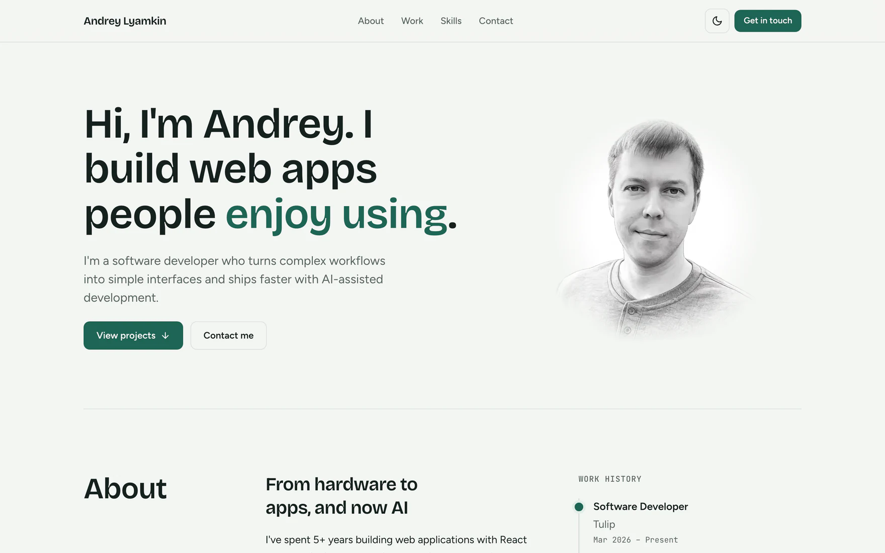

# Portfolio Website

Personal portfolio of Andrey Lyamkin, a software developer. A fast, accessible one-page site built with Next.js, React, TypeScript and Tailwind CSS.

## Live Demo

🌐 https://www.alyamkin.ca

## Features

- One-page layout: hero, about with work history, projects, skills and contact
- Responsive design for mobile, tablet and desktop
- Light and dark themes: follows the system setting by default, with a header toggle that remembers the visitor's choice
- Accessible: semantic landmarks, skip link, logical heading order, visible focus states, reduced-motion support and screen reader labels
- SEO: metadata and Open Graph image, canonical URL, `sitemap.xml`, `robots.txt`, web manifest and schema.org JSON-LD (`Person`, `WebSite`)
- Secure by default: Content Security Policy and other security headers
- Fully static: the only client-side JavaScript is the theme toggle and analytics

## Tech Stack

- [Next.js 16](https://nextjs.org) (App Router, React Compiler)
- [React 19](https://react.dev)
- [TypeScript](https://www.typescriptlang.org)
- [Tailwind CSS 4](https://tailwindcss.com) with [class-variance-authority](https://cva.style) for component variants
- [react-icons](https://react-icons.github.io/react-icons/)
- [Vercel](https://vercel.com) hosting and Web Analytics

## Screenshots

### Desktop



### Mobile


## Getting Started

Requires Node.js 20+ and [pnpm](https://pnpm.io).

```bash
git clone https://github.com/alyamkin/portfolio-web.git
cd portfolio-web
pnpm install
pnpm dev
```

Open http://localhost:3000 in your browser.

To test on a phone over the local network, list the allowed hosts in `.env.local` (comma-separated, wildcards supported) and restart the dev server:

```bash
ALLOWED_DEV_ORIGINS=<your-local-ip-or-pattern>
```

### Scripts

| Command      | Description                          |
| ------------ | ------------------------------------ |
| `pnpm dev`   | Start the development server         |
| `pnpm build` | Create a production build            |
| `pnpm start` | Serve the production build locally   |
| `pnpm lint`  | Run ESLint                           |

## Project Structure

```bash
app/                  # Root layout, page, metadata, sitemap, robots, manifest, OG image
assets/images/        # Images imported statically (sized and optimized by next/image)
components/
 ├── layout/          # Header, Footer
 ├── sections/        # Page sections (Hero, About, Projects, Skills, Contact)
 └── ui/              # Reusable primitives (Section, ButtonLink, SmartLink, StatusBadge, ThemeToggle)
config/site.ts        # Site name, URL, SEO defaults, social links, navigation
content/              # Typed page content: projects, experience, skills
lib/                  # Helpers (date formatting, structured data, theme script)
styles/globals.css    # Design tokens (colors, fonts, type scale) and base styles
next.config.ts        # Image formats and security headers
```

### Updating content

Content lives in `content/` and is separate from the components:

- **Add a project:** add an entry to `content/projects.ts`. For a screenshot, put the image in `assets/images/projects/` and set `image`; use a 16:10 or wider image, since the card shows it at 2:1. Without `image`, the card shows the shared placeholder (`assets/images/project-placeholder.webp`).
- **Add a job:** add an entry to the top of `content/experience.ts` (leave `end` empty for the current role).
- **Change skills:** edit `content/skills.ts` (`core` skills appear as cards, `other` as a list).
- **Change name, links or SEO text:** edit `config/site.ts`.

### Design tokens and theming

Colors are defined once in `styles/globals.css` with `light-dark(<light>, <dark>)` and exposed to Tailwind as utilities such as `bg-surface`, `text-muted` and `text-accent`. Components never use raw color values.

The active theme is set by a `data-theme` attribute on `<html>`:

- A small inline script (`lib/theme.ts`) applies the saved choice, or the system setting, before the page paints, so there is no flash of the wrong theme.
- `ThemeToggle` switches the theme and saves the choice in `localStorage`.
- Use the `dark:` variant for the rare styles that need more than a color change.

## Accessibility

- Skip link, landmarks (`header`, `nav`, `main`, `footer`) and sections labelled by their headings
- One `h1`, then `h2` per section and `h3` inside sections
- Descriptive alt text; decorative icons hidden from screen readers
- External links announce that they open in a new tab; repeated links include the project name for screen readers
- Lists keep their semantics in Safari/VoiceOver (`role="list"`)
- Visible focus states and `prefers-reduced-motion` support

## Performance

- Statically prerendered page
- Images served as AVIF/WebP with responsive `sizes` and blur placeholders
- Self-hosted fonts via `next/font` with `display: swap`
- React Compiler enabled

## Security

Security headers are set for every route in `next.config.ts`:

- `Content-Security-Policy`: only same-origin scripts, styles, images, fonts and connections; no plugins, framing or base-URL changes. Inline scripts are allowed because Next.js hydration, the theme script and JSON-LD are inline; a nonce-based policy would require server rendering every request.
- `Strict-Transport-Security`, `X-Content-Type-Options`, `X-Frame-Options`, `Referrer-Policy` and `Permissions-Policy`

Check dependencies with `pnpm audit` and keep Next.js up to date.

## Author

Andrey Lyamkin

- GitHub: https://github.com/alyamkin
- LinkedIn: https://www.linkedin.com/in/andreylyamkin/
